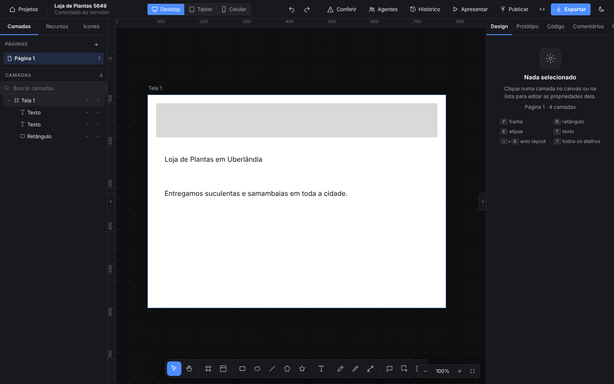

# Stylo

**Um editor visual de sites que roda no seu computador, onde o desenho é HTML e CSS de verdade — e onde pessoas e agentes de IA usam exatamente as mesmas ferramentas.**

> 🇺🇸 **English in short:** Stylo is a local-first visual editor for static websites. What you draw on the canvas *is* real HTML/CSS (frames with layout become `flex`/`grid`). A local server exposes the editor as a web panel **and** as an [MCP](https://modelcontextprotocol.io) server with 120 tools, so Claude Code, Codex, Cursor or any MCP agent can create and edit the same project a human is editing. Exports a plain HTML site (.zip), a React + Vite project (.zip) and design tokens. **Status: alpha (v0.1.0)** — it works end to end on a single machine, rough edges included. Docs are in Portuguese (pt-BR); contributions in English are welcome. See [CONTRIBUTING.md](CONTRIBUTING.md).



## Por que isso existe

Ferramentas de design desenham *imagens* de um site e alguém reescreve tudo em código depois. Agentes de IA, por outro lado, escrevem código mas não "enxergam" o design como uma pessoa.

O Stylo tenta ligar os dois lados:

- **O desenho já é código.** Cada camada vira HTML/CSS. O que aparece no canvas é o mesmo que sai na exportação.
- **Pessoa e agente editam o mesmo documento.** O painel web *nunca* mexe no documento diretamente: toda ação (criar camada, mudar cor, exportar) é uma chamada de ferramenta MCP. Então um agente faz exatamente o que o botão faz, e você vê a mudança acontecer na tela.
- **Local primeiro.** Nada de nuvem obrigatória: um servidor Node no seu computador, banco embutido (PGlite), seus dados numa pasta.

## Estado honesto: isto é um alpha

**Funciona (conferido):**

- Instalar, subir, criar conta de administração, criar projeto, desenhar telas, ver o CSS/HTML gerado, rodar a **Conferência** (acha larguras fixas que estouram no celular) e **exportar um site `.zip` que abre direto no navegador**.
- Um cliente MCP do SDK oficial conecta, lista as 120 ferramentas e executa ferramentas de verdade (criar projeto, `build_layout`, `check_design`, exportar).
- Suíte automática com mais de 600 testes e CI (Node 22 e 24) no GitHub.

**Ainda NÃO existe ou NÃO foi testado — leia antes de apostar nele:**

- É um editor de **site estático**. Não há JavaScript escrito pelo usuário, não há backend, login ou pagamento no site exportado. As interações do protótipo são só navegar/voltar/abrir URL.
- **Não importa HTML pronto** (só SVG e JSON de projetos do Stylo).
- A exportação React gera uma página por componente, sem componentes reutilizáveis, e não volta para o editor. React Native: fora de cogitação por agora.
- **Nenhum agente específico foi testado de ponta a ponta com um modelo de verdade** (Claude Code, Codex, Cursor…). O protocolo funciona com o cliente oficial do SDK; o resto é esperado, não provado. Se você testar um, conte para nós — isso vale ouro.
- PostgreSQL (em vez do PGlite) tem teste automático contra um banco descartável, mas ninguém o usa no dia a dia. Trate como experimental.
- A interface tem arestas: faltam o menu Arquivo, editor de breakpoints, pinos de comentário no canvas, editar foto pelo painel, negrito/itálico ao editar texto. A lista completa está em [docs/ROADMAP-ALPHA.md](docs/ROADMAP-ALPHA.md).
- Dados do alpha são **descartáveis**: o formato pode mudar entre versões `0.x`.
- **Não é feito para ser exposto na internet.** Rode no seu computador ou numa rede em que você confia.
- A licença atual é MIT; a definitiva ainda pode mudar (ver [NOTICE](NOTICE)).

## Comece em 2 minutos

Precisa de **Node.js 22 ou mais novo**.

> Por enquanto a versão oficial do alpha está na branch **`metaClaude`** (o comando abaixo já baixa ela). O `main` está desatualizado.

```bash
git clone --branch metaClaude https://github.com/Kaykygnb/StyloDesigner.git
cd StyloDesigner
npm install
npm start
```

Abra **http://localhost:5173/studio/**. No primeiro acesso o painel pede para criar a conta de administração. (Só para testar sem login: `STYLO_AUTH=local npm start`.)

Primeiro passeio:

1. **Novo projeto** → tecla `F` e arraste no canvas para criar uma tela.
2. `R` (retângulo) e `T` (texto) para colocar coisas; `?` mostra todos os atalhos.
3. **Conferir** (topo) aponta problemas, como largura fixa que estoura no celular.
4. Aba **Código** mostra o HTML/CSS real da camada selecionada.
5. **Exportar → Site em HTML (.zip)**, descompacte e abra o `index.html`.

Opcional: sem Chromium, as ferramentas de imagem da tela e de medida real avisam e o resto funciona. Para ligar, `npx playwright install chromium` ou `STYLO_CHROMIUM_PATH=/caminho/do/chrome`.

Mais detalhes (variáveis, dados, backups, problemas comuns): [docs/INSTALACAO.md](docs/INSTALACAO.md).

## Conecte um agente de IA

Com o servidor rodando:

```bash
claude mcp add --transport http stylo http://localhost:5173/mcp
```

No modo com contas, cadastre o agente em **Conexões MCP** (ou Administração → Agentes) e use o token Bearer gerado. Depois peça, por exemplo: *"faça uma página de cafeteria com cardápio e contato, depois confira no celular"*.

As 120 ferramentas estão em [docs/FERRAMENTAS-MCP.md](docs/FERRAMENTAS-MCP.md) (gerado do código). O que o agente recebe de instrução está em `apps/server/src/instrucoes-agente.txt`.

## Como o projeto é organizado

```
apps/server      Servidor Hono: API, MCP (HTTP e stdio), contas, entrega do painel
apps/studio      Painel web (React 19 + TypeScript + Vite)
packages/core    Documento, comandos, CSS/HTML/SVG, exportação, auditorias e as ferramentas MCP
packages/db      Prisma + PGlite/PostgreSQL (esquema e migrações)
packages/plugins Plugins embutidos (identidade, assets, acessibilidade, Tailwind, SEO, QR)
tests/           Testes (node:test) e o e2e do painel de administração
docs/            Manuais de uso e documentação de engenharia
```

Regra de ouro: **o painel nunca altera o documento direto** — faltou uma capacidade? Primeiro a ferramenta em `packages/core`, depois o botão. Detalhes em [docs/architecture/OVERVIEW.md](docs/architecture/OVERVIEW.md).

## Quer ajudar?

Vai ser muito bem-vindo. Há espaço para todo tipo de ajuda, inclusive sem escrever código:

- **Testar e relatar** — instale, tente fazer um site de verdade e abra uma issue com o que quebrou ou confundiu. Você vê o produto com olhos novos; nós não.
- **Testar com seu agente favorito** (Codex, Cursor, Claude Desktop…) e contar o resultado.
- **Corrigir algo pequeno** — veja [docs/BOAS-PRIMEIRAS-ISSUES.md](docs/BOAS-PRIMEIRAS-ISSUES.md) e o [CONTRIBUTING.md](CONTRIBUTING.md).
- **Traduzir** — a interface existe em pt-BR e en-US; a documentação está só em português.

Não é preciso pedir permissão para começar: escolha algo, abra uma issue dizendo que vai atacar, e mande um pull request.

## Mapa da documentação

| Documento | Para quê |
|---|---|
| [docs/INSTALACAO.md](docs/INSTALACAO.md) | Instalar, configurar, backups, solução de problemas |
| [docs/PAINEL.md](docs/PAINEL.md) | Guia do painel: canvas, ferramentas, abas, atalhos |
| [docs/FERRAMENTAS-MCP.md](docs/FERRAMENTAS-MCP.md) | Referência das 120 ferramentas MCP |
| [docs/ROADMAP-ALPHA.md](docs/ROADMAP-ALPHA.md) | O que falta e o que ainda precisa ser testado |
| [docs/mcp/COMPATIBILIDADE.md](docs/mcp/COMPATIBILIDADE.md) | Quais clientes MCP foram testados e como |
| [docs/ARQUITETURA.md](docs/ARQUITETURA.md) | Visão curta de como o código se organiza e por quê |
| [docs/DESENVOLVIMENTO.md](docs/DESENVOLVIMENTO.md) | Rotina de desenvolvimento e receitas (nova ferramenta, plugin, migração) |
| [CONTRIBUTING.md](CONTRIBUTING.md) | Como contribuir: rotina, testes, convenções |
| [docs/README.md](docs/README.md) | Documentação de engenharia (arquitetura, contratos, decisões) |

> `docs/planning/` e `docs/architecture/adr/` são o histórico de processo interno do projeto (tarefas, decisões). Não precisa ler isso para contribuir.

## Licença

MIT — ver [LICENSE](LICENSE) e [NOTICE](NOTICE) (licenças de terceiros). A licença definitiva do projeto ainda será decidida.
