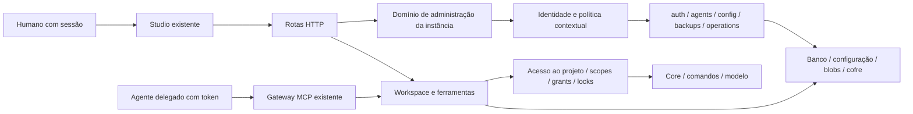
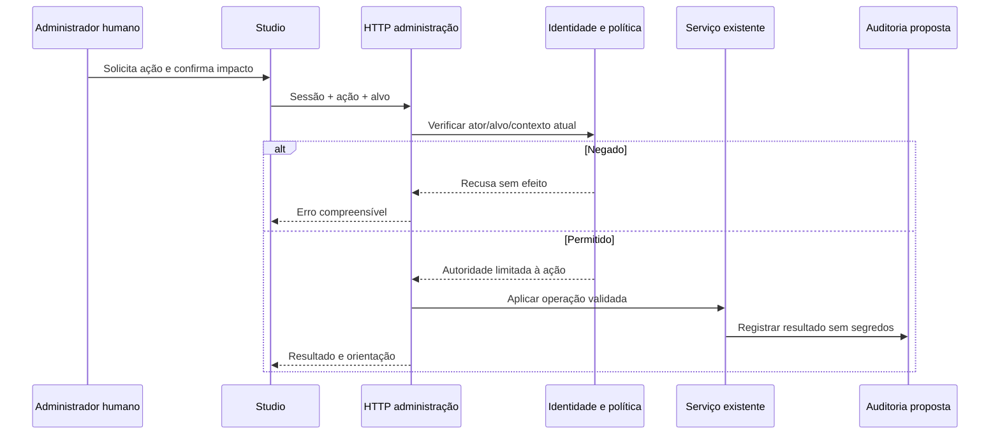

# Arquitetura recomendada — proposta

Requisitos HD formalizados e mecanismos parcialmente pendentes na [ADR 0002](../adr/0002-self-hosted-administration.md). Base factual no [inventário](CURRENT-STATE.md). A separação abaixo define domínio e contratos internos, não um novo serviço implantável nem reimplementação de auth/projetos/MCP.

## Instância, pessoas, projetos e agentes

Uma instância pertence operacionalmente a uma organização. Contém contas globais, administradores, projetos de usuários e agentes delegados. O OWNER é um papel global existente; o código permite que OWNER crie outros OWNER. HD-OWNERSHIP-02/03 estabelecem uma autoridade principal válida e múltiplos OWNERs; só principal concede OWNER. O principal não pode ser excluído/suspenso/rebaixado por ADMIN, usuários comuns ou outros OWNERs. Representação, transferência e recuperação excepcional ainda a projetar; não existe distinção principal no runtime atual.

Projeto tem proprietário e colaboradores independentes do papel global. Agente tem usuário responsável, status/token/scopes e grants por projeto. Ferramentas trabalham no workspace compartilhado; o Studio e MCP preservam os mesmos comandos, validações, locks e persistência.

ADM/ID descrevem uma fronteira coesa recomendada sobre serviços existentes; não são módulos novos já implementados. O banco e rotas existentes continuam fonte de verdade. Não criar cadastro paralelo de usuário/agente/projeto ou motor genérico de políticas antes da necessidade.

## Responsabilidades e confiança

| Fronteira | Responsabilidade | Exclusões |
|---|---|---|
| Studio/administração | Jornada compreensível, contexto da instância, confirmação de impacto, carga/erro por seção e capacidades do ator | Não autoriza só por esconder botão; não gerencia VPS |
| HTTP/identidade | Autenticar pessoa, conta ativa, ação/ator/alvo/contexto, validação antes do efeito | Token de agente não vira sessão humana administrativa |
| Administração da instância | Coordenar contas/sessões, políticas, integrações, saúde, backup, auditoria, sobre serviços atuais | Não concede leitura universal a admins por padrão |
| Projeto | Membership, leitura/escrita/notas/compartilhamento, ownership e revalidação | Papel OWNER do projeto não concede OWNER da instalação |
| Agente | Autenticar delegado, status/token/scopes, grant e teto de autoridade atual do delegante | Sem autoaprovação, autorrotação administrativa ou autoaumento de scopes/grants |
| MCP | Protocolo, identidade vinculada à sessão e adaptação de ferramentas | Não hospeda gestão de usuários/infraestrutura para compensar lacunas administrativas |
| Core/workspace | Semântica de ferramentas, alterações consistentes, locks, revisions, undo e logs de projeto | Core não conhece tenancy/HTTP/segredos administrativos |
| Operador da infraestrutura | TLS, reverse proxy, processo, SO, firewall, volumes, PG/pg_dump, recuperação externa | Nenhum controle remoto pelo Stylo sem integração explicitamente autorizada |

Código HTML/CSS/SVG/URL de projeto e entrada de agente são não confiáveis mesmo quando vêm de administrador. Cabeçalhos Forwarded/Host/Origin são não confiáveis até uma política explícita de proxy/hosts; não confiar em qualquer proxy nem desligar DNS-rebinding/CSRF.

## Autorização recomendada

Manter RBAC existente como base. Acrescentar capacidades explícitas e regras de contexto apenas onde o papel amplo é insuficiente: `instance.config.operational`, `instance.security.manage`, `instance.credentials.manage`, `users.manage`, `owners.manage`, `project.share`, `agents.delegate`, `backups.restore`. `project.share` foi aprovado na ADM-DEC-04 como scope separado de write e ainda não está implementado. Os outros nomes seguem vocabulário proposto, não endpoints. Não substituir read/comment/write/export unilateralmente.

Cada decisão recebe principal autenticado, ação, recurso/alvo, papel global ou membership apropriado, estado atual, modo local/accounts e intenção. Validar no servidor antes do efeito; manter ausência de mutação parcial. Para agente, permissão efetiva proposta é a interseção: agente ativo + delegante autorizado/ativo + grant + scopes/capacidade + papel no projeto + regra da ferramenta. Não usar união de poderes nem role global do dono como passe administrativo.

Regra de não ampliação: um agente só delega acesso se recebeu essa capacidade explicitamente, para recurso autorizado e até seu teto de autoridade. Hoje write do agente proprietário já permite compartilhar: conservar comportamento até decisão explícita e plano compatível, sem afirmar que a regra nova já vale. Auto-grant do projeto recém-criado é distinto de auto-grant em projeto alheio.

A proteção OWNER proposta examina ator **e alvo**, não apenas role de destino; protege perda do último acesso administrativo e alterações concorrentes. Aprovação beta de adminOf não autoriza ADMIN resetar OWNER. Política entre ADMINs, múltiplos OWNER, acesso extraordinário e efeito da suspensão do delegante exigem decisão humana.

## Fluxos recomendados

1. **Instalação:** operador prepara volumes/TLS/proxy e restringe bootstrap. Primeiro OWNER é provisionado por sessão de instalação controlada, de uso único/atômica (proposta); antes de publicar, confirma contas, hosts/origem e backup. Inicialização não será acesso remoto público irrestrito.
2. **Operação comum:** proprietário entra no Studio, encontra visão geral/pessoas/agentes/projetos/integrações/backup. Serviços atuais processam ação após gate; resultado e trilha aparecem sem editar JSON. Instalação inicial e opções avançadas podem continuar requerendo operador; a interface comum não deve expor configuração sensível como tarefa manual.
3. **Delegação de agente:** humano autorizado cria identidade e scopes, recebe token uma vez, concede projeto e fornece URL/snippet. Sessão mantém identidade; revalidação/refusal em revogação, rotação, troca de scopes e suspensão seguem política aprovada. Não confiar apenas no SID, não elevar agente por bearer humano. SSE humano deve usar identidade da sessão e ACL de projeto para presença/notificação; query de nome/file não é autorização. Revogar sessão deve tratar canal já aberto. Essa proteção é proposta, não demonstrada pelo binding atual de workspace.
4. **Ação sensível:** servidor resolve ator/alvo/contexto, verifica capacidade e reautenticação se aprovada; interface mostra impacto e pede confirmação; efeito + evento têm semântica de sucesso/falha definida. Evento não inclui senha/token/chave nem documento.
5. **Recuperação/restore:** usar política aprovada e mecanismo fora de banda controlado se nenhum admin entra. Backup contempla DB+blobs+config+chave em conjunto protegido; validar em ambiente isolado antes de substituir produção. Agendamento para próximo boot atual não equivale a restauro completo comprovado.

Auditoria administrativa é proposta: reaproveita persistência existente, com eventos sensíveis distintos de Operation de design e AuthEvent. Campos mínimos: identificador, data, ator/tipo, ação, alvo, resultado, correlação e mudanças não secretas. Atomicidade, gravação de recusas, retenção e quem consulta/exporta são decisões de segurança; não prometer inviolabilidade absoluta em VPS administrada pelo proprietário.

## Painel: evoluir o existente

Reorganizar WorkspacePanel/abas atuais em visão geral, pessoas/sessões, projetos/acessos, agentes, integrações, segurança/atividade e backups. Preservar catálogo/editor e modo individual com conta/senha obrigatórias no modelo alvo; legado sem login precisa migração avaliada. Mostrar estado real de operações assíncronas, falha/retentativa por seção e limites por adapter (PG externo, reinício pendente). Convites por e-mail, dashboard novo e lista de sessões MCP são evoluções condicionais, não pré-requisitos automáticos.

Confirmações contextuais para restore/reset/remoção/revogação e controles derivados de capacidades são insumos da DOC-STUDIO-003. Redesign estético pertence à DOC-STUDIO-005. Não reconstruir painel nem criar task para cada sugestão.

## Operação e evolução

HTTPS/domínio público requer contrato de origem externa, hosts permitidos, proxy confiável e cookie Secure configurável preservando HTTP local. Hoje o guard bloqueia esse uso, como reproduzido no inventário. Health público deve ser mínimo; diagnóstico detalhado autenticado é proposta. Accounts é padrão; local sem conta é legado temporário a inventariar/migrar e fixture explícito durante transição; não é opção humana permanente conforme HD-IDENTITY-01/02/04 nem perfil de VPS pública.

Rate limit/login, payload bounds, caps MCP/SSE e slots renderer já existem; completar quotas/monitoramento conforme carga real e custos de provedores. Rever concorrência de setup, OWNER e auditoria transacional; autorização no início da chamada não cancela operações em voo.

Para futura multi-organização: decisão comercial primeiro; depois org membership separado de role da instância, contexto obrigatório em recursos/queries/constraints/URLs e auditoria, secrets/assets/backups/quotas isolados, testes de acesso cruzado. Não inserir tenant fictício agora nem compartilhar a base entre empresas por mero seletor GUI.

## Diretrizes humanas que atualizam esta proposta

A [ADR](../adr/0002-self-hosted-administration.md) é a fonte dos 21 HD. Identidade individual/conta local offline, senha e GUI de provisionamento são requisitos; titularidade institucional/contactos são distintos de login diário. Administração scoped/compartilhamento essencial devem aproveitar membership/grants existentes, sem entidades empresariais obrigatórias. A política completa de capacidades, transferência, offline recovery e efeito em agentes/em voo segue aberta.

A recomendação antiga de manter acesso local permanente foi superada: preservar dados e caminhos durante migração, não oferecer bypass humano final. GUI para envio/recuperação é requisito com e-mail opcional; OAuth SMTP não autoriza login federado. Ver [plano técnico](IDENTITY-ONBOARDING-RECOVERY.md). A deliberação humana não autorizou uma migração de produção ou implementação integral dessas funcionalidades.
